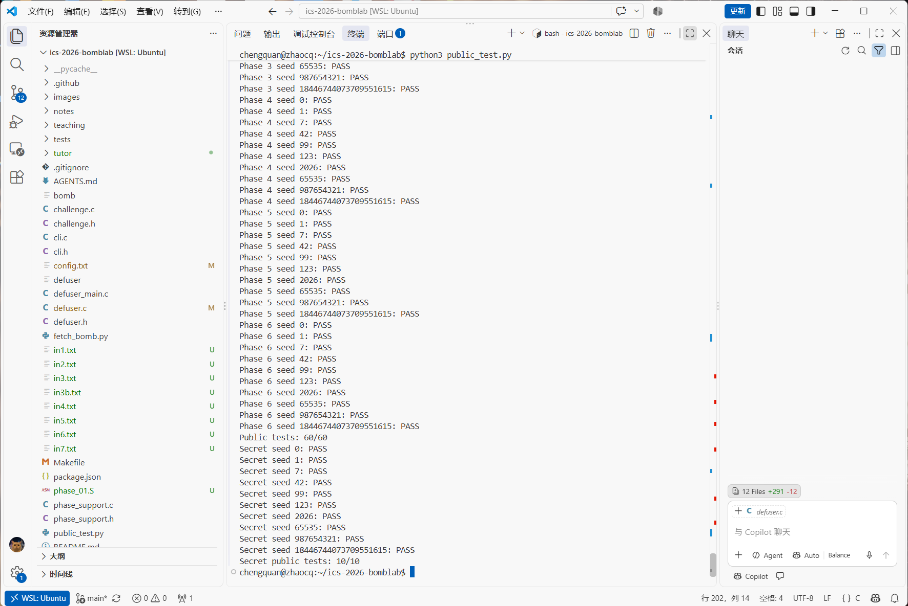
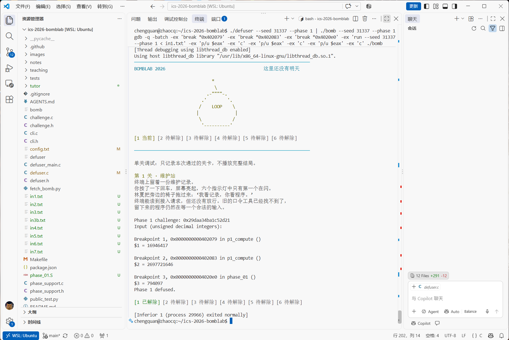
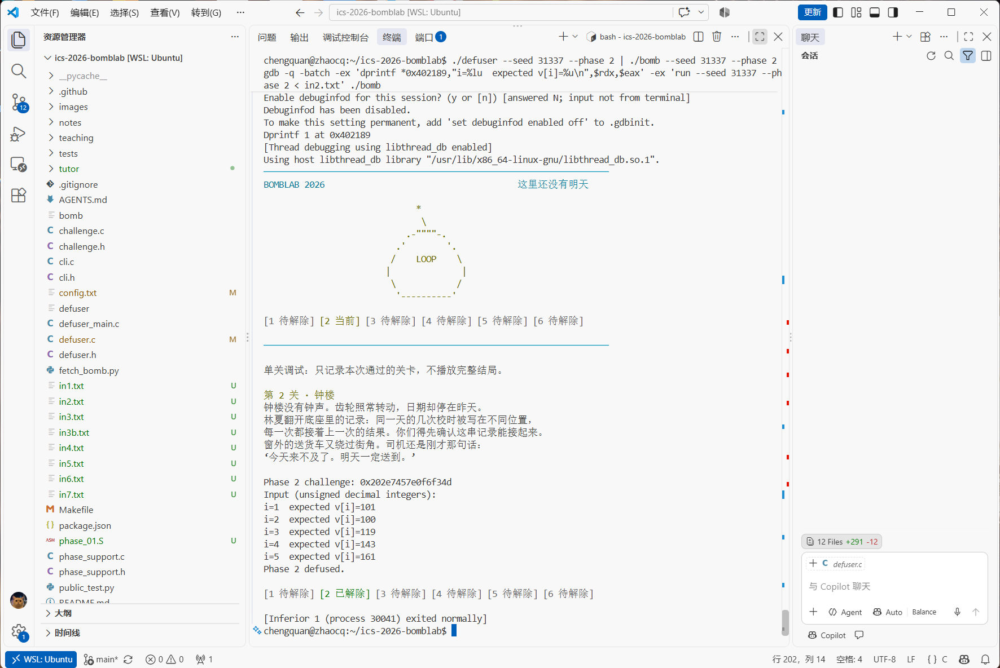
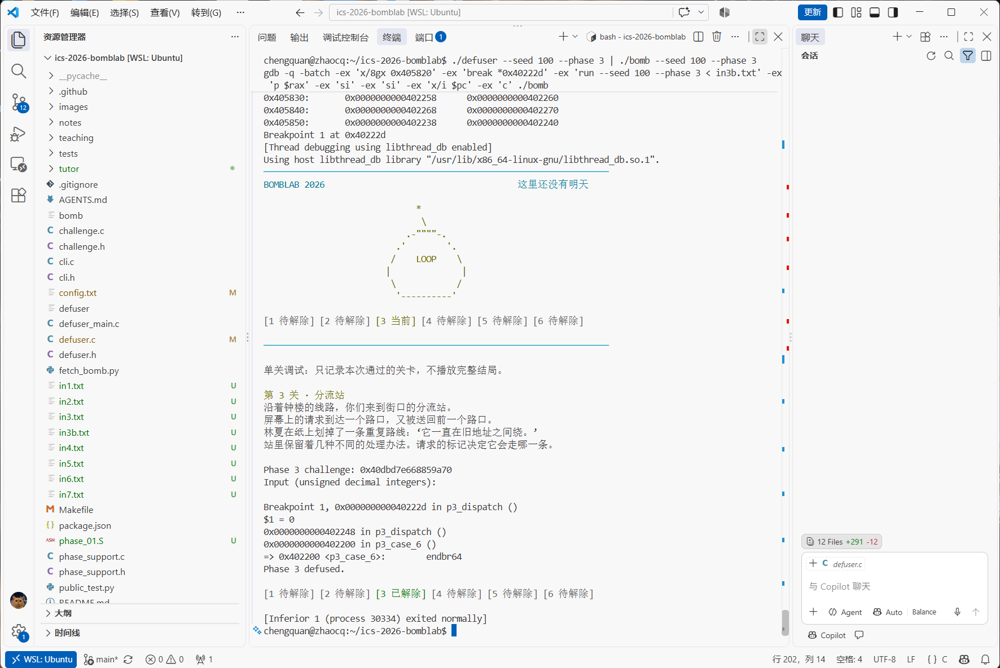
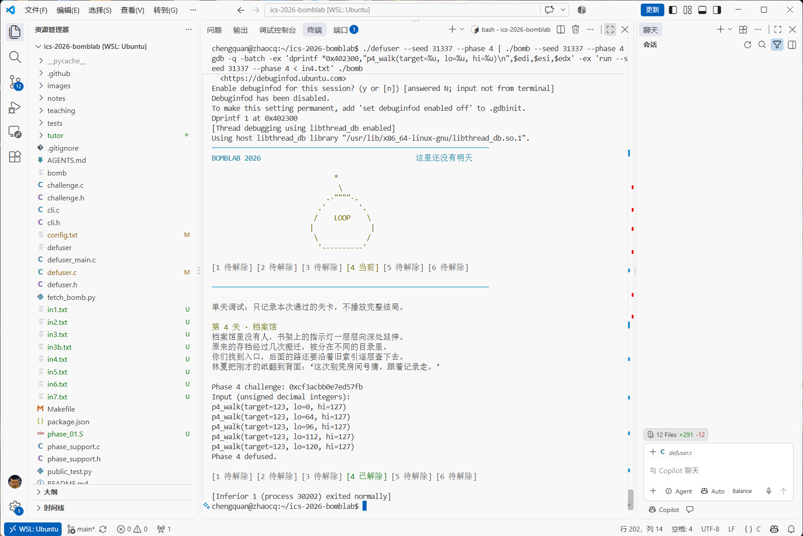
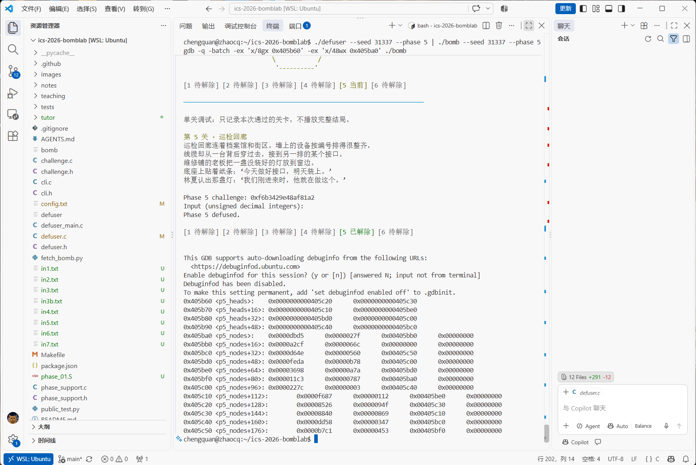
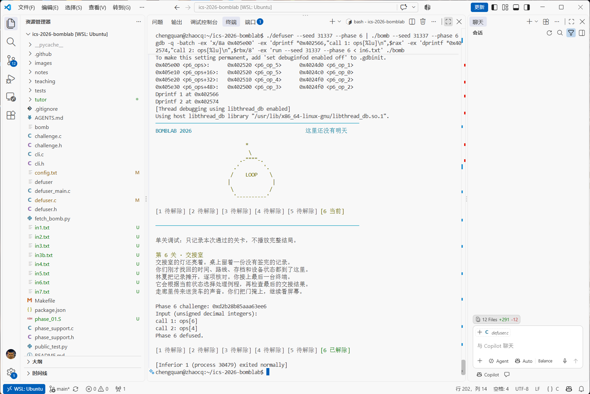
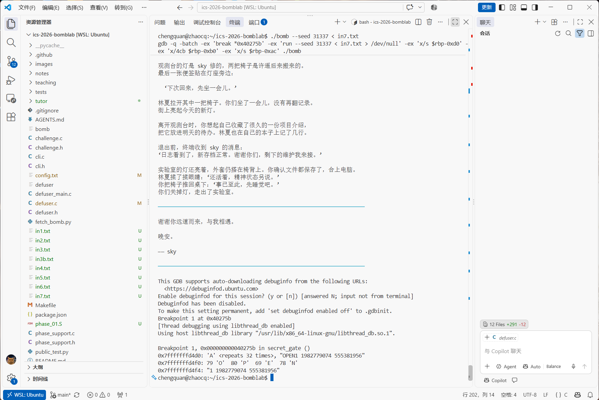

# Lab2 BombLab 实验报告

## 0. 总体情况

| 关卡 | 知识点 | 状态 |
|---|---|---|
| 第 1 关 | 函数调用、参数传递、返回值 | ✅ 完成 |
| 第 2 关 | 数组、循环、递推关系 | ✅ 完成 |
| 第 3 关 | switch 与跳转表 | ✅ 完成 |
| 第 4 关 | 递归调用与返回过程 | ✅ 完成 |
| 第 5 关 | 结构体布局、指针、链表遍历 | ✅ 完成 |
| 第 6 关 | 函数指针表与间接调用 | ✅ 完成 |
| Honor | 栈缓冲区布局、小端序 | ✅ 完成 |

`python3 public_test.py` 结果：六关公开测试 60/60，Honor 公开测试 10/10。



### 分析方法

1. 用 `objdump -d --no-show-raw-insn -M intel bomb` 导出汇编，静态阅读每关的结构。
2. 从 `valid_u32_fields(input, n)` 调用前写入 `esi` 的常数确定口令里整数的个数；从 `sscanf` 的地址参数确定每个数在栈上的位置。
3. 找到与输入比较的 `cmp`，向前追踪被比较的值如何由 challenge（入口时在 `rsi`）计算得到。
4. 跳转表、链表、函数指针表等存放在 `.rodata` 中的数据，用 GDB 的 `x` 命令读取。
5. 用 GDB 的断点、`dprintf` 在运行时打印中间值，验证推出的关系。
6. 把关系写进 `defuser.c`，用公开列表之外的 seed 验证（第 3 关用 seed 100，其余关卡用 seed 31337）。

下文中 `c` 表示 challenge，所有中间量都按 `uint32_t` 计算，与汇编中 32 位寄存器的回绕行为一致。

---

## 1. 第 1 关：函数调用与参数传递

### 关键汇编

```asm
; phase_01
mov    esi,0x1                  ; valid_u32_fields(input, 1)：口令 1 个数
lea    rdx,[rbp-0x14]           ; sscanf 结果存在 [rbp-0x14]
mov    rdi,r12                  ; r12 = challenge
call   p1_compute
cmp    DWORD PTR [rbp-0x14],eax ; 输入 == p1_compute(c)

; p1_compute
mov    r8d,edi                  ; lo = c 的低 32 位
shr    rax,0x20                 ; hi = c >> 32
shr    rdx,0x10                 ; mid = (c >> 16) 的低 32 位
mov    r9d,eax ; mov esi,eax    ; 参数：edi = lo, esi = hi
call   p1_step0                 ; lea eax,[rdi+rdi*4]; add esi,0xd209; xor eax,esi
mov    ecx,eax                  ; ecx 暂存 a
mov    rsi,rdx ; mov edi,r9d    ; 参数：edi = hi, esi = mid
call   p1_step1                 ; sub edi,esi; lea eax,[rdi+rdi*4+0xef90]
mov    esi,r8d ; mov edi,eax    ; 参数：edi = b, esi = lo
call   p1_step2                 ; lea eax,[rsi+0x510d]; xor eax,edi
xor    eax,ecx                  ; 结果再异或 a
```

### 推理过程

`p1_compute` 先把 64 位的 challenge 拆成 `lo`、`hi`、`mid` 三个 32 位量，再依次调用三个小函数，前一个的结果作为后一个的参数。`p1_step0` 的返回值在调用 `p1_step1`、`p1_step2` 期间一直保存在 `ecx` 里；三个小函数都不修改 `rcx/rdx/r8/r9`，所以编译器可以用这些寄存器跨调用保存值。`lea eax,[rdi+rdi*4]` 是编译器用地址计算实现的乘 5。

### 计算关系

```c
uint32_t lo  = (uint32_t)c;
uint32_t hi  = (uint32_t)(c >> 32);
uint32_t mid = (uint32_t)(c >> 16);
uint32_t a = (lo * 5) ^ (hi + 0xd209);       // p1_step0(lo, hi)
uint32_t b = (hi - mid) * 5 + 0xef90;        // p1_step1(hi, mid)
answer = ((lo + 0x510d) ^ b) ^ a;            // p1_step2(b, lo) ^ a
```

### 验证（seed 31337）

在 `0x402079`、`0x402083`、`0x4020e0` 三处设断点，依次读到 a = 16946417、b = 2697721646、最终答案 794097，与 C 代码的计算结果一致，并通过第 1 关。



---

## 2. 第 2 关：数组、循环与递推

### 关键汇编

```asm
mov    esi,0x6                  ; 6 个数
lea    rdx,[rbp-0x40]           ; v[0]
lea    rcx,[rbp-0x3c]           ; v[1]
lea    r8,[rbp-0x38]            ; v[2]
lea    r9,[rbp-0x34]            ; v[3]
push   rax                      ; v[5] = rbp-0x2c（第 8 个参数）
push   rax                      ; v[4] = rbp-0x30（第 7 个参数）
call   sscanf

mov    rax,r13 ; shr rax,0x2f ; and eax,0x7f
cmp    esi,eax                  ; v[0] == (c >> 47) & 0x7f

mov    edi,0x6
mov    edx,0x1                  ; i = 1
loop:
lea    ecx,[rdx+0x14]           ; 移位数 i + 20
mov    rax,r13 ; shr rax,cl
and    eax,0x3f
add    eax,esi                  ; + v[i-1]
mov    esi,DWORD PTR [rbp+rdx*4-0x40]   ; esi = v[i]
xor    eax,edi                  ; ^ edi
cmp    esi,eax
add    rdx,0x1 ; add edi,0x6
cmp    rdx,0x6 ; jne loop
```

### 推理过程

`sscanf` 有 8 个参数，前 6 个用寄存器传递，后两个通过 `push` 放在栈上。六个整数的地址从 `rbp-0x40` 开始每隔 4 字节一个，构成数组 `v[6]`。循环中 `rdx` 是下标 i，`[rbp+rdx*4-0x40]` 就是 `v[i]`；`edi` 从 6 开始每轮加 6，等于 `6*i`；`esi` 先保存 `v[0]`，每轮比较后换成 `v[i]`，作为下一轮的上一项，形成递推。

### 计算关系

```c
v[0] = (c >> 47) & 0x7f;
for (i = 1; i < 6; i++)
    v[i] = (v[i-1] + ((c >> (20 + i)) & 0x3f)) ^ (6 * i);
```

### 验证（seed 31337）

在 `cmp esi,eax`（`0x402189`）处用 `dprintf` 打印每轮的 i 与期望值，得到 i = 1～5 时依次为 101、100、119、143、161，与 solver 输出一致。



---

## 3. 第 3 关：switch 与跳转表

### 关键汇编

```asm
; phase_03
mov    esi,0x2                  ; 2 个数
mov    edi,r12d ; and edi,0x7
cmp    DWORD PTR [rbp-0x18],edi ; v[0] == c & 7，记为 k
mov    rax,r12 ; shr rax,0x3
mov    rsi,r12 ; shr rsi,0x20
xor    esi,eax                  ; x = (c >> 32) ^ (c >> 3)
call   p3_dispatch              ; p3_dispatch(k, x)
cmp    DWORD PTR [rbp-0x14],eax ; v[1] == p3_dispatch(k, x)

; p3_dispatch
mov    eax,edi ; mov edi,esi
cmp    eax,0x7 ; ja default
notrack jmp QWORD PTR [rax*8+0x405820]
```

### 推理过程

`p3_dispatch` 先检查 k ≤ 7，然后以 `0x405820` 为基址、每项 8 字节查表间接跳转，这是 switch 编译成的跳转表。表的内容不在代码段，用 `x/8gx 0x405820` 读出 8 个目标地址，再与 `p3_dispatch` 中各条 `jmp p3_case_?` 的地址一一对应：

| k | 表项地址 | 实际执行 | 计算 |
|---|---|---|---|
| 0 | 0x402248 | p3_case_6 | `(x ^ 0x4272) + (x >> 1)` |
| 1 | 0x402250 | p3_case_1 | `x*5 + 0xb679` |
| 2 | 0x402258 | p3_case_3 | `(x*2) ^ 0x10e9` |
| 3 | 0x402260 | p3_case_2 | `(x ^ 0x9ed2) + (x >> 1)` |
| 4 | 0x402268 | p3_case_0 | `x*5 + 0x41a5a` |
| 5 | 0x402270 | p3_case_4 | `x*3 + 0x1757` |
| 6 | 0x402238 | p3_case_5 | `(x*4) ^ 8` |
| 7 | 0x402240 | p3_case_7 | `x*5 + 0x20116` |

各 case 函数的计算由 `lea`、`shr`、`xor`、`add` 翻译得到。

### 计算关系

```c
k = c & 7;
x = (uint32_t)(c >> 32) ^ (uint32_t)(c >> 3);
answer = { k, case_table[k](x) };
```

### 验证（seed 100）

选择 seed 100 是因为它的 k = 0。在 `0x40222d` 停下后 `p $rax` 显示 0，单步两次后程序进入 `p3_case_6`，与表中的对应关系一致，第 3 关通过。



---

## 4. 第 4 关：递归调用与返回过程

### 关键汇编

```asm
; phase_04：p4_walk(target, lo, hi, key)
mov    edi,r12d ; and edi,0x7f  ; target = c & 0x7f
xor    esi,esi                  ; lo = 0
mov    edx,0x7f                 ; hi = 127
shr    rcx,0x7 ; shr rax,0x20
xor    ecx,eax                  ; key = (c >> 7) ^ (c >> 32)
call   p4_walk
cmp    DWORD PTR [rbp-0x14],eax

; p4_walk
mov    eax,edi
mov    edi,edx ; sub edi,esi ; shr edi,1 ; add edi,esi   ; mid = lo + (hi-lo)/2
cmp    edi,eax ; je  base       ; mid == target
lea    ebx,[rdi+rcx*1]          ; ebx = mid + key
cmp    eax,edi ; jb  left
lea    esi,[rdi+0x1]            ; 右：lo = mid + 1
call   p4_walk
lea    eax,[rax+rax*4] ; xor eax,ebx ; xor eax,0x17
left:
lea    edx,[rdi-0x1]            ; 左：hi = mid - 1
call   p4_walk
lea    eax,[rax+rax*4] ; xor eax,ebx ; xor eax,0x1a
base:
lea    eax,[rdi+0xdf] ; xor eax,ecx  ; (mid + 0xdf) ^ key
```

### 推理过程

`p4_walk` 的结构是在 [lo, hi] 上做二分查找：每层计算中点，等于 target 时到达递归出口；否则按 `jb`（无符号小于）决定向左或向右递归。`ebx` 是被调用者保存寄存器，函数开头先 `push rbx`，再把 `mid + key` 存进去，递归返回后仍可使用。递归下降时只缩小区间，所有计算都在返回过程中完成：每一层把下一层的返回值乘 5，异或 `mid + key`，再异或方向常数（左 0x1a，右 0x17）。因此结果取决于整条查找路径。target 在 0～127 之内，初始区间是 [0, 127]，所以一定能找到。

### 计算关系

```c
uint32_t walk(uint32_t t, uint32_t lo, uint32_t hi, uint32_t key) {
    uint32_t mid = lo + ((hi - lo) >> 1);
    if (mid == t) return (mid + 0xdf) ^ key;
    if (t < mid) return ((walk(t, lo, mid - 1, key) * 5) ^ (mid + key)) ^ 0x1a;
    return ((walk(t, mid + 1, hi, key) * 5) ^ (mid + key)) ^ 0x17;
}
answer = walk(c & 0x7f, 0, 127, (uint32_t)(c >> 7) ^ (uint32_t)(c >> 32));
```

### 验证（seed 31337）

在 `p4_walk` 入口用 `dprintf` 打印每次调用的参数，target = 123，区间依次为 [0,127] → [64,127] → [96,127] → [112,127] → [120,127]，第 5 层 mid = 123 时到达出口，与二分查找的分析一致。



---

## 5. 第 5 关：结构体、指针与链表

### 关键汇编

```asm
; phase_05
lea    rsi,[rbp-0x14]           ; 第 2 个参数：输出指针 &last
mov    rdi,r12
call   p5_traverse
cmp    DWORD PTR [rbp-0x1c],edx ; v[0] == 返回值 acc
mov    eax,DWORD PTR [rbp-0x14]
cmp    DWORD PTR [rbp-0x18],eax ; v[1] == last

; p5_traverse(c, &last)
and    eax,0x7
mov    rdx,QWORD PTR [rax*8+0x405b60]   ; node = p5_heads[c & 7]
shr    rax,0x6 ; shr rdi,0x20 ; xor eax,edi
xor    eax,0x88f9                       ; acc = ((c>>6) ^ (c>>32)) ^ 0x88f9
mov    esi,DWORD PTR [rdx+0x4]          ; tag
lea    eax,[rax+rax*2]
add    eax,DWORD PTR [rdx]              ; acc = acc*3 + val
mov    DWORD PTR [r8],esi               ; *last = tag
xor    eax,esi                          ; acc ^= tag
and    edi,0x3 ; je ret                 ; steps = (c >> 3) & 3
loop:
mov    rdx,QWORD PTR [rdx+0x8]          ; node = node->next
lea    eax,[rax+rax*2] ; add eax,[rdx] ; xor eax,esi ; mov [r8],esi
cmp    edi,ecx ; jae loop
```

### 推理过程

由访问偏移可以恢复节点结构：`[rdx]` 是 4 字节的 val，`[rdx+4]` 是 4 字节的 tag，`[rdx+8]` 是 8 字节的 next 指针，每个节点 16 字节：

```c
struct node { uint32_t val; uint32_t tag; struct node *next; };
```

`p5_traverse` 通过第二个参数（指针）把最后访问节点的 tag 写回调用者，相当于第二个返回值。链表头表 `p5_heads` 和节点数组 `p5_nodes` 都在 `.rodata`，用 `x/8gx 0x405b60` 和 `x/48wx 0x405ba0` 读出。节点编号 = (地址 − 0x405ba0) / 16：

| # | val | tag | next |
|---|---|---|---|
| 0 | 0xdbd5 | 0x27f | 1 |
| 1 | 0xa2cf | 0x66c | NULL |
| 2 | 0xd64e | 0x560 | 11 |
| 3 | 0xfeda | 0xb78 | 6 |
| 4 | 0x3698 | 0xa7a | 3 |
| 5 | 0x11c3 | 0x787 | 0 |
| 6 | 0x227c | 0x003 | 10 |
| 7 | 0xf687 | 0x112 | 4 |
| 8 | 0x8526 | 0x94f | 9 |
| 9 | 0x8840 | 0x869 | 7 |
| 10 | 0xdd58 | 0x347 | 2 |
| 11 | 0xb7c1 | 0x453 | 5 |

`p5_heads` 对应的节点编号为 {8, 9, 7, 4, 3, 6, 10, 2}。solver 无法访问炸弹进程的内存，因此把这张表写进 `defuser.c`，用数组下标代替指针。

### 计算关系

```c
n = heads[c & 7];
steps = (c >> 3) & 3;
acc = ((uint32_t)(c >> 6) ^ (uint32_t)(c >> 32)) ^ 0x88f9;
acc = (acc * 3 + n.val) ^ n.tag;  last = n.tag;
repeat steps times:
    n = n.next;
    acc = (acc * 3 + n.val) ^ n.tag;  last = n.tag;
answer = { acc, last };
```

### 验证（seed 31337）

challenge = 0xf6b3429e48af81a2，`c & 7 = 2`，起始节点为 #7（0x405c10）；`(c >> 3) & 3 = 0`，只访问第一个节点。截图中包含读出的 `p5_heads` 与 `p5_nodes` 内存，第 5 关通过。



---

## 6. 第 6 关：函数指针表与间接调用

### 关键汇编

```asm
; p6_dispatch(c)
mov    rbx,rdi
shr    rdi,0x6
mov    rax,rbx ; shr rax,0x20
xor    edi,eax                          ; x = (c >> 6) ^ (c >> 32)
mov    rax,rbx
and    ebx,0x38                         ; ((c >> 3) & 7) * 8
and    eax,0x7                          ; c & 7
call   QWORD PTR [rax*8+0x405e00]       ; r = ops[c & 7](x)
xor    eax,0xf22f
mov    edi,eax
call   QWORD PTR [rbx+0x405e00]         ; r = ops[(c >> 3) & 7](r)
add    eax,0xd9ad
```

### 推理过程

`0x405e00` 处是 8 个函数指针组成的数组，`call QWORD PTR [...]` 是通过函数指针的间接调用。第一次调用用 `rax*8` 作为偏移；第二次的 `c & 0x38` 取出第 3～5 位，数值本身等于 `((c >> 3) & 7) * 8`，所以不再乘 8。用 `x/8a 0x405e00` 读表，GDB 会标出符号名：

`ops[] = {p6_op_5, p6_op_1, p6_op_5, p6_op_0, p6_op_4, p6_op_2, p6_op_3, p6_op_2}`

六个操作函数的翻译（`ror`/`rol` 为 32 位循环移位）：

| 函数 | 关键指令 | 计算 |
|---|---|---|
| op_0 | `lea eax,[rdi+0x419f]; shr edi,3; xor` | `(x + 0x419f) ^ (x >> 3)` |
| op_1 | `shr eax,5; xor eax,edi; add 0x37b2` | `((x >> 5) ^ x) + 0x37b2` |
| op_2 | `ror eax,5` | `(x >> 5) \| (x << 27)` |
| op_3 | `rol eax,1; xor 0xb6d8` | `((x << 1) \| (x >> 31)) ^ 0xb6d8` |
| op_4 | `xor 0xbdbf; lea eax,[rax+rdi*8]` | `(x ^ 0xbdbf) + x*8` |
| op_5 | `lea edx,[rdi*8]; sub edx,edi; shl eax,7; add 0x1794; xor` | `((x << 7) + 0x1794) ^ (x*7)` |

### 计算关系

```c
x = (uint32_t)(c >> 6) ^ (uint32_t)(c >> 32);
r = ops[c & 7](x) ^ 0xf22f;
answer = ops[(c >> 3) & 7](r) + 0xd9ad;
```

### 验证（seed 31337）

challenge = 0xd2b28b85aaa63ee6，`c & 7 = 6`，`(c >> 3) & 7 = 4`。在两条 `call` 处用 `dprintf` 打印下标，得到 `ops[6]`、`ops[4]`，即依次调用 `p6_op_3`、`p6_op_4`，第 6 关通过。



---

## 7. Honor：栈缓冲区布局与小端序

### 关键汇编

```asm
; secret_gate(line, challenge, context)
lea    r12,[rbp-0xd0]                   ; buf
mov    ecx,0x14 ; rep stos QWORD PTR [rdi],rax
mov    DWORD PTR [rdi],0x0              ; 清零 164 字节
call   strlen
sub    rax,0x24 ; cmp rax,0x7f ; jbe ok ; 36 <= len <= 163
call   secret_copy                      ; 逐字节复制到 '\0'，相当于 strcpy(buf, line)
cmp    DWORD PTR [rbp-0xb0],0x4e45504f  ; buf + 32 处的 4 字节
lea    rdi,[rbp-0xac]                   ; buf + 36
call   secret_phase

; secret_phase(s, ch, ctx)：3 个数 a, b, c
mov    ecx,r13d ; and ecx,0x3
cmp    DWORD PTR [rbp-0x2c],ecx         ; a == ctx & 3，记为 k
imul   r9d,ecx,0xad24
shr    rsi,0x20 ; xor esi,r12d          ; S = (ch >> 32) ^ ch
shr    r8,0x20  ; xor r8d,r13d          ; T = (ctx >> 32) ^ ctx
shr    r13,0x10 ; xor r9d,r13d          ; r9 = (k * 0xad24) ^ (ctx >> 16)
mov    edi,esi ; xor edi,r8d
call   secret_mix                       ; rol eax,3; add 0xad24; xor 0x806a
xor    eax,r9d
cmp    DWORD PTR [rbp-0x28],eax         ; b == secret_mix(S ^ T) ^ r9
shr    esi,0x3
lea    edx,[r8+rcx*1+0x806a] ; add edx,esi
xor    eax,edx
cmp    eax,DWORD PTR [rbp-0x24]         ; c == b ^ (T + k + 0x806a + (S >> 3))
```

### 推理过程

`secret_gate` 在栈上开了一块 164 字节的缓冲区，把输入的整行复制进去，再把偏移 32（`0xd0 - 0xb0`）处的 4 字节当作整数和 `0x4e45504f` 比较。x86 是小端序，这个整数在内存中从低地址到高地址依次是 `0x4f 0x50 0x45 0x4e`，即字符 `'O' 'P' 'E' 'N'`。检查通过后，从偏移 36 开始的字符串交给 `secret_phase`，按普通关卡的方式解析 3 个整数。长度检查用 `len - 36 <= 127` 的无符号比较同时实现了上下界。

`context` 由驱动根据前六关的口令调用 `transcript_context` 算出，因此 Honor 依赖前六关的正确答案。

输入行格式：

```
[32 字节填充][OPEN][k b c]
 偏移 0..31   32..35  36..
```

### 计算关系

```c
k = ctx & 3;
S = (uint32_t)(ch >> 32) ^ (uint32_t)ch;
T = (uint32_t)(ctx >> 32) ^ (uint32_t)ctx;
m = (rol32(S ^ T, 3) + 0xad24) ^ 0x806a;
b = m ^ (k * 0xad24) ^ (uint32_t)(ctx >> 16);
c = b ^ (T + k + 0x806a + (S >> 3));
line = "AAAA...A(32个)" "OPEN" "k b c";
```

### 验证（seed 31337）

在 `secret_copy` 返回后（`0x40275b`）读取缓冲区：`x/s $rbp-0xd0` 显示 32 个 `'A'` 后接 `"OPEN1 1982779074 555381956"`；`x/4cb $rbp-0xb0` 显示 `79 'O' 80 'P' 69 'E' 78 'N'`，验证了小端序分析；完整运行输出 `Secret phase defused.`。



---

## 8. 参考资料与辅助工具

- 课程主页及仓库 `README.md`、`tutor/README.md`
- 《深入理解计算机系统》第 3 章（机器级表示）
- 工具：`objdump`（导出反汇编）、`gdb`（断点、单步、`dprintf`、`x` 读内存）、`gcc`/`make`、`python3 public_test.py`
- AI 辅助：使用 Claude 辅助阅读汇编、讲解调用约定和 GDB 用法、核对推出的计算关系，并协助整理本报告的结构。各关的结论均通过 GDB 运行时观察和公开列表之外的 seed 实际验证。